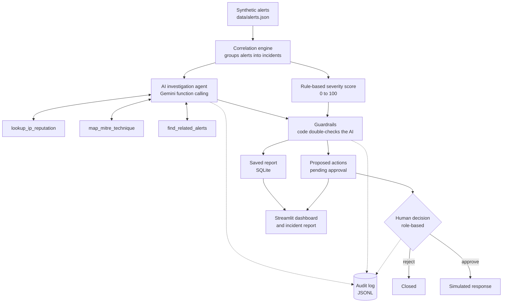

# SOC Triage and Incident Response Agent (PS-07)

An agentic AI system that investigates security alerts, groups related alerts into incidents, scores their severity, and proposes response actions that **a human must approve** before anything happens.

Built solo for the JKLU AI Buildathon 1.0 (2026), problem statement **PS-07: Intelligent Cybersecurity SOC Triage and Incident Response Agent**.

> All data is synthetic and every response action is simulated. No real systems are touched.

## The problem

A security operations centre receives thousands of alerts a day. Most are noise, a few are real attacks, and analysts burn out sorting them. This project shows how an AI agent can do the first pass (investigate, correlate, prioritise, explain) while people keep control of every decision.

## How it works



1. **Correlation** merges 45 alerts into 3 incidents (plus 30 routine alerts) using shared external IPs and host/user/time windows.
2. **Scoring** gives each incident a transparent 0-100 score: threat intel (40), furthest MITRE ATT&CK stage (30), alert volume (20), raw severity (10).
3. **The agent** (Gemini, function calling) decides which tools to call, reads the results, retries failures, and returns a verdict with evidence and uncertainties. It may only use facts returned by its tools.
4. **Guardrails** check the AI against the score in code: an incident rated medium or above cannot be dismissed as a false positive, confidence is capped when threat intel is missing, and unusually low severities are raised.
5. **Approval workflow:** the agent only proposes actions. Sensitive ones (block IP, isolate host, reset credentials) need an admin. Approved actions run in a simulator.
6. **Audit log** records every reasoning step, tool call, result, retry, guardrail change, and approval or refusal.

## How it meets the event rules

| Requirement | Where it is handled |
|---|---|
| True agentic behaviour (plan, tools, recover) | `app/agent/investigator.py`: multi-step tool loop, tool retries, bad-argument recovery |
| Tool and API integration | `app/agent/tools_registry.py`: threat-intel lookup, MITRE mapping, log search |
| Error recovery | Tool timeouts retried; AI service outages retried with model fallback (`app/agent/llm_retry.py`) |
| No fabricated facts | Prompt rules, mock threat-intel returns `no_data` instead of guessing, missing evidence is reported as an uncertainty |
| Human-in-the-loop | `app/agent/approvals.py`: actions stay `pending_approval` until a person decides |
| Role-based access control | `app/auth.py` plus enforcement in the approval code and the dashboard |
| Audit and explainability | `app/agent/audit.py`, `logs/audit_log.jsonl`, dashboard Audit log tab, incident reports |
| Synthetic data only | `data/generate_data.py` builds everything; no real PII or systems |

## Roles

| User | Role | Can do |
|---|---|---|
| `viewer1` | viewer | Read everything |
| `analyst1`, `analyst2` | analyst | Run investigations, approve safe actions, reject any action |
| `admin1` | admin | Everything, including sensitive actions |

## Project structure

```
app/
  auth.py                 users and role rules
  config.py               model name and API key loading
  tools/                  threat_intel.py, mitre_map.py, search_logs.py
  agent/
    investigator.py       the agent loop (Gemini function calling)
    tools_registry.py     tools exposed to the agent
    correlation.py        groups alerts into incidents
    scoring.py            rule-based severity score
    guardrails.py         code checks on the AI's report
    approvals.py          approval queue and RBAC (SQLite)
    actions.py            action classification and simulation
    pipeline.py           investigate -> guardrails -> save -> queue
    llm_retry.py          retries and model fallback for AI outages
    reports.py            incident report generator
    store.py              saved reports and audit log reading
    audit.py              audit log
    evaluation.py         accuracy check on cases with known answers
data/generate_data.py     builds the synthetic alerts and threat intel
dashboard.py              Streamlit dashboard
run_incident.py           list incidents, or investigate one
run_agent.py              investigate a single alert
approve.py                approve or reject actions from the terminal
make_report.py            write an incident report file
evaluate.py               accuracy check
test_*.py                 automated checks (no AI needed except test_llm.py)
```

## Setup (Windows PowerShell)

Requires Python 3.11 or newer and a Gemini API key from [Google AI Studio](https://aistudio.google.com/apikey).

```
git clone https://github.com/AdityaChaudhary-CS-jp/soc-agent.git
cd soc-agent
python -m venv .venv
.venv\Scripts\activate
python -m pip install -r requirements.txt
```

Create a file named `.env` in the project folder with one line (never commit this file):

```
GEMINI_API_KEY=your_key_here
```

Generate the synthetic data and run the checks:

```
python data/generate_data.py
python test_tools.py
python test_scoring.py
python test_approvals.py
python test_reports.py
python test_resilience.py
```

## Run it

Dashboard:

```
python -m streamlit run dashboard.py
```

Pick a user in the sidebar, open an incident, click **Investigate with AI**, then use the **Approvals** tab. Try approving a sensitive action as `analyst1` (refused), then as `admin1` (approved, simulated).

From the terminal:

```
python run_incident.py                 # list incidents and scores (no AI call)
python run_incident.py INC-001         # investigate one incident
python approve.py list                 # pending actions
python approve.py approve 1 --user admin1 --comment "confirmed"
python make_report.py INC-001          # write reports/INC-001.md
python evaluate.py 4                   # quick accuracy check on 4 cases
```

## Data

`data/generate_data.py` creates 45 alerts: two real attack chains (brute force to root access; phishing to malware to command-and-control), one ambiguous case (a large outbound transfer to an IP with no threat-intel data, plus a backup job that might explain it), and 30 routine alerts. A mock threat-intel file stands in for services such as VirusTotal or AbuseIPDB.

## Evaluation

One accuracy run on the synthetic dataset: 5/10 exact matches. All 3 real incidents were classified correctly, including the ambiguous one, and no real attack was missed. The 5 misses were routine single alerts that the agent escalated instead of dismissing. Backup models may have answered some cases after the main model's free daily limit was reached. Details: docs/evaluation.md.

## Limitations

- Data and threat intelligence are synthetic; the system has not been tested on real logs.
- Response actions are simulated only.
- The agent depends on an external AI service. Outages are retried and logged, but without the service no new investigation can run (saved reports remain viewable).
- The accuracy check uses labels from the synthetic data generator, so it measures behaviour on this dataset, not real-world accuracy.

## Tech stack

Python, Google Gemini (`google-genai`) with function calling, SQLite, Streamlit, MITRE ATT&CK technique mapping.
